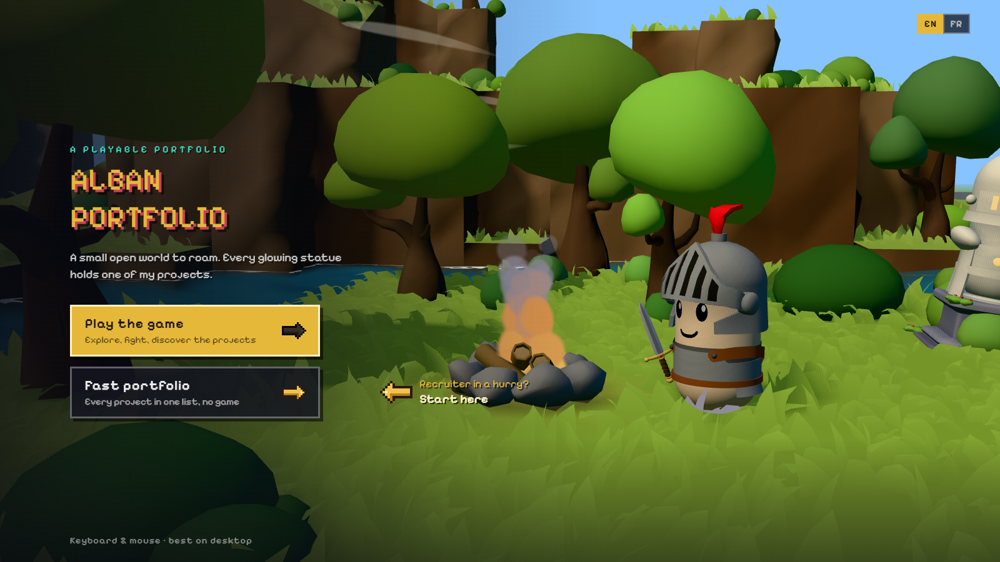
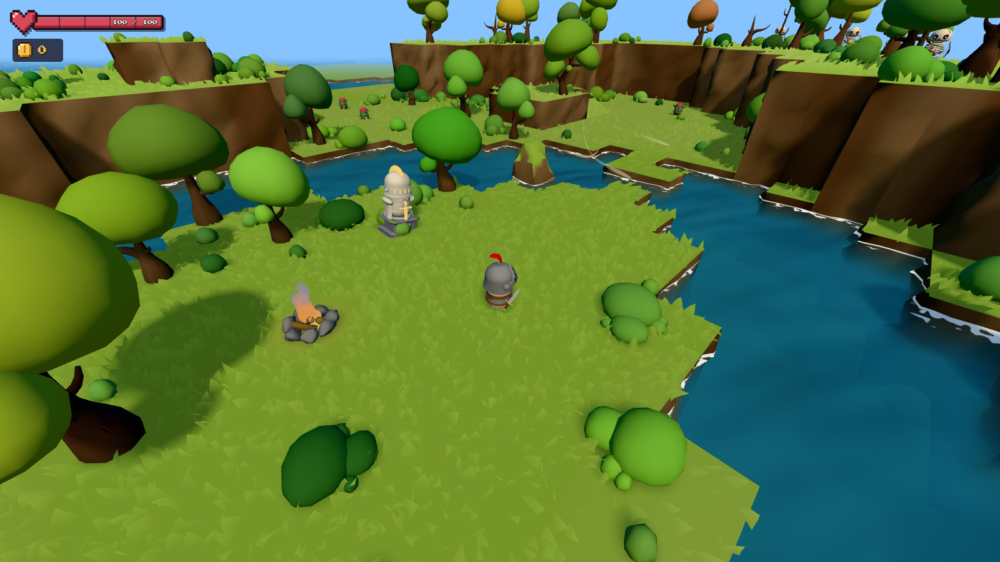

<h1 align="center">Alban Lembrez</h1>

  <b>Game & C++ developer</b> · 3rd-year Computer Science student at Epitech · Open to internships

  
  

I build game engines, multiplayer games and the tools around them. I like problems where the
architecture matters: entity-component systems, networked simulation, plugin loading, rendering.

  
   
  My portfolio is a game: every glowing statue in the world holds one of my projects.

## Featured projects

<table>
  <tr>
    <td width="50%" valign="top">
      <h3><a href="https://github.com/Saitamadupauvre/RPG-Portfolio">RPG-Portfolio</a></h3>
      
      
Open-world, low-poly action RPG in the browser. Hand-made map editor, Unity-style animator fed by Blender clips, enemy AI with A* pathfinding, event-driven layered architecture. A classic list view for recruiters in a hurry.

      
<code>TypeScript</code> <code>Three.js</code> <code>WebGL</code> <code>Vite</code> <code>Blender</code>

    </td>
    <td width="50%" valign="top">
      <h3><a href="https://github.com/Saitamadupauvre/RType">R-Type</a></h3>
      
Networked multiplayer remake of the classic shoot'em up, on our own C++20 engine. Up to four players on an authoritative UDP server; gameplay scripted in Lua, so the engine knows nothing about R-Type. Protocol and engine documented with MkDocs.

      
<code>C++20</code> <code>UDP</code> <code>Lua</code> <code>CMake</code>

      <h3><a href="https://github.com/Saitamadupauvre/Glyphwright">Glyphwright</a></h3>
      
2D game engine with an ECS and hot-swappable renderer libraries: the same game runs as ASCII or Sixel/Kitty graphics in a terminal, or in a native window, with its own editor.

      
<code>C++</code> <code>ECS</code> <code>CMake</code>

      <h3><a href="https://github.com/Saitamadupauvre/Game-Girl">Game GIRL</a></h3>
      
Custom handheld console: Raspberry Pi 4 for embedded Linux, GBA emulation and the launcher, STM32 bare-metal firmware for inputs and battery telemetry.

      
<code>C</code> <code>Embedded Linux</code> <code>STM32</code>

    </td>
  </tr>
</table>

<b>More projects</b>

 

| Project | What it is | Stack |
|---|---|---|
| [Zappy](https://github.com/Saitamadupauvre/zappy) | Networked game where AI agents compete to evolve; I built the server and protocol | C, TCP, Python |
| [Raytracer](https://github.com/Saitamadupauvre/raytracer) | Plugin-based raytracer with dynamically loaded shapes, lights and materials | C++20 |
| [Arcade](https://github.com/Saitamadupauvre/arcade) | Retro game platform; game and graphics libraries swapped at runtime | C++, dlopen |
| [brotatomato](https://github.com/Saitamadupauvre/brotatomato) | Roguelite made in a 2-day game jam: the tomatoes you carry are your lives | Godot 4 |
| [Wolf3D](https://github.com/Saitamadupauvre/wolf3d) | Raycasting FPS engine with textures, enemies and sound | C |
| [The Plazza](https://github.com/Saitamadupauvre/theplazza) | Multi-process, multi-threaded kitchen simulation | C++, threads, IPC |

## Tech

- **Languages:** C++ · C · TypeScript · Python · Lua · GDScript
- **Game & graphics:** Three.js / WebGL · Godot 4 · custom engines (ECS, raycasting, ray tracing)
- **Systems:** TCP/UDP networking · multithreading · dynamic libraries · Linux
- **Tooling:** CMake · Git · GitHub Actions · Docker · Blender
